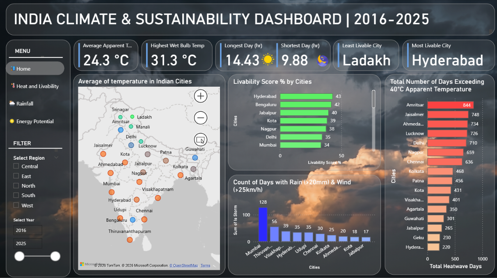

<div align="center">

# 🌦️ Weather Data Analysis of India
### Exploring a decade of weather patterns across 24 Indian locations

**From climate exploration and statistical hypothesis testing to temperature prediction and interactive visual analytics.**


</div>

---

## 📌 Project Overview

How do temperature, rainfall, humidity, sunlight, and geography interact across India? Which locations experience more extreme heat or rainfall variability? Can historical meteorological variables help estimate daily mean temperature?

This project explores these questions using **80K+ daily weather records across 24 Indian locations over the 2016–2025 period**. It combines data preparation, exploratory data analysis (EDA), geospatial visualization, statistical hypothesis testing, feature engineering, and a Linear Regression model. An interactive Power BI dashboard complements the analysis by turning the findings into accessible visual insights.

The objective is not simply to plot weather data, but to **identify meaningful climate patterns, test observations statistically, and evaluate how well a model estimates daily mean temperature**.

## 🎯 Project Highlights

- **80K+ records** spanning a decade of daily weather observations.
- **24 Indian locations** covering diverse geographic and climatic conditions.
- **Climate risk exploration** covering extreme-heat days, rainfall deviations, and high-wind/heavy-rain days.
- **Statistical validation** using Pearson correlation, Welch’s independent t-test, and one-way ANOVA.
- **Temperature model:** \(R^2 = 0.9648\), MAE = **1.3423°C**, RMSE = **1.8080°C** on the held-out test period.
- **Interactive reporting** through Plotly/Folium visualizations and a Power BI dashboard.

## 🧭 Questions Explored

The project investigates several practical questions:

1. How do average temperatures and year-to-year temperature patterns vary across locations?
2. Which locations record the most days with maximum air temperature or apparent temperature above **40°C**?
3. How do rainfall totals and rainfall deviations from each location’s historical average change over time?
4. Which locations record days with both heavy rainfall and high wind speeds?
5. How does sunshine availability vary geographically, and what might it suggest about relative solar potential?
6. How are rainfall, cloud cover, sunshine, humidity, and temperature related?
7. Are temperature distributions statistically different across cities and between coastal and inland groups?
8. How accurately can daily mean temperature be estimated from same-day meteorological features?

## 🗺️ Geographic Coverage

The analysis covers 24 locations across broad regions of India.

| Region | Locations |
|---|---|
| **North** | Delhi, Srinagar, Ladakh, Amritsar, Manali, Nainital, Lucknow |
| **East** | Patna, Kolkata |
| **Northeast** | Guwahati, Agartala, Geku |
| **West** | Ahmedabad, Jaisalmer, Mumbai |
| **Central** | Kota, Jabalpur, Nagpur |
| **South** | Chennai, Bengaluru, Hyderabad, Visakhapatnam, Udupi, Thiruvananthapuram |

*Note: Ladakh represents a broader geographic region rather than a single city. The regional groupings are used for analysis and presentation.*

## 🧰 Tech Stack

| Tool / Library | How it is used |
|---|---|
| **Python** | Core analysis and data processing |
| **Pandas & NumPy** | Data cleaning, transformation, aggregation, and feature engineering |
| **Matplotlib & Seaborn** | Statistical and exploratory plots |
| **Plotly** | Interactive charts and correlation heatmaps |
| **Folium** | Geographic visualizations and city-level maps |
| **SciPy** | Pearson correlation, Welch’s t-test, and ANOVA |
| **Statsmodels** | Variance Inflation Factor (VIF) analysis |
| **Scikit-learn** | Feature scaling and Linear Regression workflow |
| **Power BI** | Interactive dashboard and visual reporting |
| **Jupyter Notebook** | Reproducible, step-by-step analysis |

## 🔄 Workflow

### 1. Data preparation and quality checks
- Combined the source data files into a unified dataset.
- Converted date fields to appropriate datetime formats and sorted observations chronologically.
- Inspected missing values and handled missing mean-humidity values using an estimate derived from the minimum and maximum humidity columns.
- Checked the date index for missing daily timestamps.
- Converted sunshine and daylight durations from seconds to hours.
- Mapped latitude/longitude coordinates to location names using a distance-based lookup to avoid fragile exact floating-point comparisons.

### 2. Exploratory and climate-focused analysis
- Compared temperature distributions and year-wise temperature changes across locations.
- Counted extreme-heat days using thresholds for maximum air temperature and apparent temperature.
- Examined yearly rainfall totals, deviations from each location’s average rainfall, and the frequency of unusually wet or dry years.
- Identified candidate storm days using a project-defined combination of high wind speed and heavy precipitation.
- Compared sunshine-to-daylight ratios as a proxy for relative sunshine availability.
- Explored daylight-duration variation against latitude.
- Visualized geographic differences using interactive charts and maps.

### 3. Statistical analysis
Visual patterns were followed by statistical tests to assess selected relationships:

| Method | Application | Main takeaway |
|---|---|---|
| **Pearson correlation** | Rainfall vs. mean cloud cover | The notebook reports a moderate positive correlation of approximately **0.44**. |
| **Welch’s independent t-test** | Mean temperatures in selected coastal locations vs. the remaining inland group | Tests whether the two groups have different mean temperatures without assuming equal variances. |
| **One-way ANOVA** | Mean temperatures across locations | Tests whether at least one location’s mean temperature differs from the others. |
| **Correlation matrix** | Multiple meteorological variables | Helps inspect the direction and strength of pairwise linear relationships. |
| **VIF analysis** | Selected numeric model features | Used to assess multicollinearity among predictors. |

**Interpretation note:** Statistical significance does not establish causation. The coastal/inland grouping is a simplified classification, and the tests do not isolate geography from all other possible influences. Correlation also captures linear association rather than every possible relationship.

### 4. Feature engineering and temperature estimation
The modeling workflow includes:
- Cyclical month encoding using **sine and cosine transformations**, preserving the circular nature of the calendar.
- One-hot encoding of location categories.
- Standardization of continuous numerical features.
- A chronological train/test split to keep the evaluation period later than the training period.
- Linear Regression to estimate `temperature_2m_mean`.
- Evaluation using **R², Mean Absolute Error (MAE), and Root Mean Squared Error (RMSE)**.
- Residual inspection, actual-versus-predicted plots, and city-wise error analysis.

## 📈 Model Performance

The Linear Regression model was trained on observations through **2022** and evaluated on the held-out **2023–2024** period.

<div align="center">

| Metric | Test result | What it means |
|:---:|:---:|---|
| **R²** | **0.9648** | Explains approximately 96.48% of the target variance in this test set. |
| **MAE** | **1.3423°C** | Average absolute prediction error of about 1.34°C. |
| **RMSE** | **1.8080°C** | Penalizes larger errors more heavily than MAE. |

</div>

### What the results suggest

- The model fits the held-out observations strongly under this evaluation setup.
- RMSE being higher than MAE indicates that some predictions have larger errors than the average absolute error.
- City-wise error analysis found higher errors in colder or more climatically extreme locations such as **Ladakh, Manali, and Srinagar**.
- Differences in the amount and distribution of training data across locations may contribute to uneven performance.

> **Important scope limitation:** This is a same-day temperature estimation model because it uses meteorological measurements from the day whose mean temperature is being estimated. It should **not** be described as a future-weather forecasting system. The high R² must be interpreted in this context.

## 🔎 Selected Findings

- **Temperature and apparent temperature** have a very strong positive correlation in the notebook’s correlation analysis (approximately **0.98**).
- **Rainfall and cloud cover** show a moderate positive correlation (approximately **0.44**).
- **Sunshine duration** is negatively correlated with rainfall (approximately **−0.57**) and cloud cover (approximately **−0.55**) in the notebook’s analysis.
- The ANOVA analysis reports statistically significant temperature differences across locations.
- The Welch t-test reports a statistically significant difference between the selected coastal group and the remaining locations.
- The project-defined rainfall and wind thresholds help compare the frequency of candidate storm days across locations.

These findings describe patterns in the analyzed dataset. They should not be interpreted as proof that one variable directly causes another.

## 📊 Power BI Dashboard

The Power BI dashboard complements the notebook with an interactive overview of:

- Heatwave risk indicators
- Rainfall patterns and variability
- Storm activity
- Water-balance-related measures
- Solar potential and sunshine availability
- City-level climate comparisons

**Dashboard preview:**



To display the preview on GitHub, save a screenshot at `images/weather-dashboard.png`, or change the path above to match your repository. If the `.pbix` file is included in the repository, link to it here as well.

## 🚀 Getting Started

### Prerequisites

- Python 3.x
- Jupyter Notebook or JupyterLab
- The weather dataset used by the notebook

### 1. Clone the repository

```bash
git clone <YOUR_GITHUB_REPOSITORY_URL>
cd <YOUR_REPOSITORY_FOLDER>
```

### 2. Create and activate a virtual environment (recommended)

```bash
python -m venv .venv
```

**Windows**
```bash
.venv\Scripts\activate
```

**macOS / Linux**
```bash
source .venv/bin/activate
```

### 3. Install dependencies

```bash
pip install pandas numpy matplotlib seaborn plotly folium scipy statsmodels scikit-learn jupyter
```

### 4. Add the dataset

Place the combined dataset in the location expected by the notebook. The current notebook reads a file named:

```text
complete_weather_data.csv
```

Update the notebook’s file path if you store the dataset elsewhere. If the dataset is too large or has redistribution restrictions, document its source and access instructions rather than committing it directly to GitHub.

### 5. Run the notebook

```bash
jupyter notebook Weather_Analysis.ipynb
```

Run the cells in order to reproduce the data preparation, analysis, visualizations, statistical tests, and model evaluation. Some Plotly and Folium outputs are interactive within a compatible notebook environment.

## 📁 Suggested Repository Structure

```text
weather-data-analysis/
├── Weather_Analysis.ipynb
├── complete_weather_data.csv       
├── dashboard/
│   └── weather_dashboard.pbix      
├── images/
│   └── weather-dashboard.png       
├── requirements.txt                
└── README.md
```

Adjust this structure to match the files you actually publish. Do not include placeholder files unless you create them.

## ⚠️ Data and Methodology Notes

- The dataset covers the **2016–2025** period, but coverage is not complete for every location-year. The notebook notes that **7 of the 24 locations are missing three years of data**, so some year-to-year comparisons require caution.
- The missing mean-humidity values are estimated from the available minimum and maximum humidity fields. This is an approximation, not a measured daily mean.
- The project’s heat and storm counts use explicit thresholds for comparison; they are analytical definitions, not official meteorological warnings.
- Sunshine ratio is used as a proxy for relative sunshine availability, not a formal engineering estimate of photovoltaic energy generation.
- Results depend on the data source, its coverage, and the chosen preprocessing and threshold definitions.

## 🌱 Future Improvements

- Add confidence intervals and effect sizes alongside p-values.
- Investigate statistical assumptions and account for dependence between daily observations when testing climate patterns.
- Compare Linear Regression with tree-based models and time-series approaches using a strictly defined forecasting setup.
- Evaluate models with multiple time-based splits and compare performance across climate zones.
- Add forecast-time features and lagged observations if developing a genuine future-temperature forecasting model.
- Publish dashboard screenshots and document the dataset source and data dictionary.

## 👤 Author

**Harkeerat Singh**  
LinkedIn: [Harkeerat06](https://www.linkedin.com/in/harkeerat06) <br>
GitHub: [Harkeerat06](https://github.com/Harkeerat06)

---

<div align="center">

**Built to explore climate patterns through data, statistics, and machine learning.** 🌍

</div>
